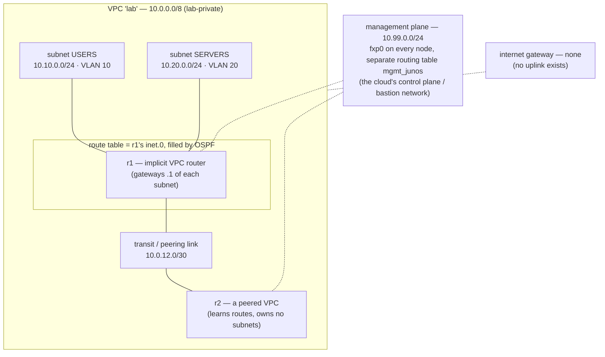

# Day 3 — the lab, described as a cloud

The lab built on days 1 and 2 already contains every primitive a cloud network sells. This
note names which lab object plays which cloud part, answers the day's questions, and designs
(and tests) a least-privilege split between a services cluster and a management cluster.

## The topology, as a cloud would draw it



## Mapping table

| Cloud concept | What it is in a cloud | The lab object that plays it | How to see it |
| --- | --- | --- | --- |
| VPC / VNet | a private address space with its own routing | the `10.0.0.0/8` lab ranges, isolated bridges with no `<forward>` | `virsh net-dumpxml lab-l1` |
| Subnet | a slice of the VPC tied to one segment | VLAN 10 → `10.10.0.0/24`, VLAN 20 → `10.20.0.0/24` | `show vlans` on sw1 |
| Implicit VPC router | the hidden `.1` of every subnet | r1's subinterfaces `ge-0/0/1.10` / `.20` (router-on-a-stick) | `show interfaces terse` on r1 |
| Route table | per-subnet next-hop rules | `inet.0` on each router | `show route` |
| Route propagation | the cloud adds routes for you | OSPF advertising the VLAN subnets to r2 | `show route protocol ospf` on r2 |
| VPC peering / transit gateway | joins two networks' routing | the r1–r2 /30 plus the OSPF adjacency | `show ospf neighbor` |
| Security group | stateful, per-interface allow rules | a stateless firewall filter on an interface (see below) | `show firewall filter …` |
| Network ACL | stateless, per-subnet rules, evaluated in order | the same Junos filter: terms are evaluated top-down, first match wins | term order in `show configuration firewall` |
| Internet gateway | the route to `0.0.0.0/0` that goes out | **does not exist** — no uplink, no default route in `inet.0` | `show route 0.0.0.0/0 exact` → empty |
| NAT gateway | lets private subnets out without being reachable | **deliberately absent** | — |
| Control plane / bastion network | the provider's API and management path, apart from tenant traffic | `fxp0` on `10.99.0.0/24`, in its own routing table `mgmt_junos` | `show route table mgmt_junos.inet.0` |
| Availability zone | an independent failure domain | (not yet — one host; day 6 adds two spines as separate failure points) | — |

## The day's questions

**What is a "private subnet" in the lab?** Every subnet. A cloud calls a subnet private when
its route table has no route to an internet gateway. Here `inet.0` on every router has no
default route at all, so USERS and SERVERS are private by the same definition: they can
reach each other and the peered router, and nothing else.

**What would an internet gateway be, given the lab has no uplink?** It would be two things
the lab refuses to have: a bridge with a physical uplink (or a libvirt network in `nat` or
`route` mode) and a `0.0.0.0/0` route on r1 pointing at it. An internet gateway is not a box.
It is a route plus a path, and the lab has neither.

**Where does NAT live, and why does the lab not have one?** In a cloud, NAT sits in a public
subnet and private subnets send their default route to it. In the lab it would be a source-NAT
rule on whichever node held the uplink, or libvirt's `nat` forward mode on the host. The lab
leaves it out on purpose. NAT is how a private network gets out to the world, and this lab must never be able to
reach a real network. The isolation is structural: the networks are libvirt `isolated` (no
`<forward>` element), so even with the host firewall off there is no route out to remove.

## Design: services cluster and management cluster, least privilege

Two clusters, addressed from the plan in [docs/addressing.md](../docs/addressing.md):

| Cluster | Subnet | VLAN | Who lives there |
| --- | --- | --- | --- |
| services | 10.20.0.0/24 | 20 (SERVERS) | the workloads |
| management | 10.30.0.0/24 | 30 (MANAGEMENT) | operators, monitoring, automation (day 7's control node) |
| users | 10.10.0.0/24 | 10 (USERS) | clients of the services |

Flows, written as allow rules (everything not listed is denied):

| From | To | Allowed | Why |
| --- | --- | --- | --- |
| management | services | SSH (22), NETCONF (830), ICMP | operators administer services |
| services | management | replies only | a service never opens a session into management |
| users | services | the service's port only (e.g. 443), ICMP | clients use the service, not its shell |
| users | management | nothing | users have no business on the admin network |
| outside the VPC (r2, the "peer") | services | nothing, until a rule names it | peering joins routing; it should not grant access |
| any | node control planes (`fxp0`) | only from `10.99.0.0/24` | the control plane is reachable only from its own network |

Two notes on the design:

- **Stateless vs stateful.** A cloud security group remembers the session and lets replies
  back in on its own. A Junos firewall filter does not, so "replies only" must be written
  as a rule (`tcp-established`) — that gap is day 4's material. The SRX zones that make it
  stateful are day 4 too.
- **Routing is not access.** OSPF tells r2 where `10.20.0.0/24` is; it does not decide
  whether r2 may go there. Route tables and filters answer different questions, and the test
  below shows them disagreeing.

## Tested: the peer can route to services but cannot reach them

The last row of the flow table, implemented as an input filter on r1's link to r2 — a
security group on the transit link:

```text
set firewall family inet filter SG-SERVERS term ospf from protocol ospf
set firewall family inet filter SG-SERVERS term ospf then accept
set firewall family inet filter SG-SERVERS term to-servers from destination-address 10.20.0.0/24
set firewall family inet filter SG-SERVERS term to-servers then count denied-to-servers
set firewall family inet filter SG-SERVERS term to-servers then discard
set firewall family inet filter SG-SERVERS term default then accept
set interfaces ge-0/0/0 unit 0 family inet filter input SG-SERVERS
```

The `ospf` term sits first on purpose: a filter that discards the routing protocol breaks
the route table, and then every other result means nothing.

Committed inside `commit confirmed 5`, then tested from r2:

| Test from r2 | Before | After |
| --- | --- | --- |
| ping users gateway 10.10.0.1 | 2/2 | 3/3 |
| ping services gateway 10.20.0.1 | 2/2 | **0/3** |
| OSPF neighbour r1 | Full | Full |
| r2's route to 10.20.0.0/24 | present | **still present** |

```text
admin@r1> show firewall filter SG-SERVERS
Counters:
Name                    Bytes    Packets
denied-to-servers         252          3
```

Three pings sent, three packets counted: the filter dropped them, not the routing. r2 still
held the route to the services subnet. It just could not use it.

The commit warned: `requires 'L2 and L3 Filters' license`. The vJunos lab image enforces
the filter anyway; on production hardware that warning means a licence to buy.

The commit was never confirmed. Five minutes later Junos rolled it back by itself, leaving
the day-2 baseline in place for day 4.
