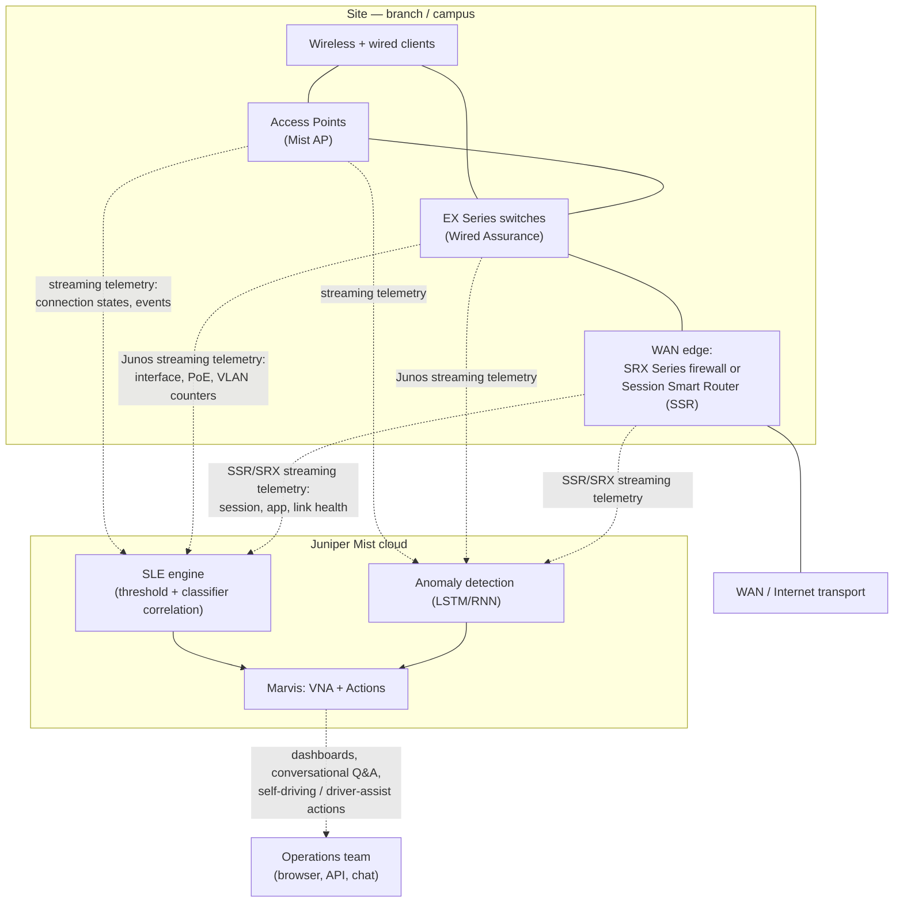

# Day 5 — Mist AI: architecture and assurance

**No emulation today.** Mist is a cloud service. There is no vMist image to boot, and
pretending a virtual AP is a deployment would be dishonest. The exercise is architecture:
what Mist actually watches, what it decides, what it does, and where that reasoning can be
wrong — then an honest mapping onto the lab built on days 1–4.

## Architecture: a real enterprise deployment

Telemetry is produced at the edge — AP, switch, and WAN device — and consumed in the cloud.
Nothing is analyzed locally; the device's job is to stream state, not to decide. The decision
layer (SLE engine, anomaly detection, Marvis) lives entirely in the Mist cloud and runs as a
microservices platform, so features ship without a device reboot or an on-box upgrade window.
Source: [Mist Platform Overview](https://www.mist.com/wp-content/uploads/Mist-Platform-Overview.pdf).

## Data flow: data → decision → action → failure mode

| Capability | Data | Decision | Action | Failure mode (false positive) |
| --- | --- | --- | --- | --- |
| **SLEs** (Service-Level Expectations) | AP/switch/WAN-edge streaming telemetry correlated against configured thresholds (throughput, capacity, AP/switch health, coverage, etc.) | Mist classifies each metric as meeting or missing its threshold, and attributes a miss to one of a fixed set of classifiers | Dashboard shows the failing SLE and the classifier breakdown; feeds anomaly detection and Marvis Actions | A threshold set too tight for the site's real traffic pattern (e.g. a capacity SLE tuned for an office applied to a high-density lecture hall) flags "poor experience" on a network that is actually fine — an operator-config problem, not a sensing one |
| **Anomaly detection** | Continuous telemetry and logs from APs, switches, and WAN edges, fed into third-generation LSTM/RNN models that learn a per-network baseline | Model flags a deviation from the learned baseline as one of a documented set of anomaly types — on APs: cable defects, VLAN issues, Ethernet errors, loops, low power, slow speeds; on switches: cable problems, device health degradation, negotiation mismatches, STP loops, DHCP pool exhaustion; on WAN edges: invalid backup firmware, gateway health, route/port flapping, HA link failures, LTE signal weakness, ISP reachability, congestion; site-level: DNS/DHCP/ARP failures and error spikes | Raises an anomaly event, visible on the SLE timeline and consumed by Marvis for root-cause correlation | Juniper states the anomaly-detection models are tuned to keep efficacy above 95% to minimize false positives, which concedes they exist — a baseline learned during an atypical week (holiday traffic, a migration) becomes the wrong reference point afterward, and normal traffic reads as anomalous until the model re-learns |
| **Client-level assurance / dynamic packet capture** | Unconfirmed — the Juniper documentation page for this feature returned HTTP 404 on 2026-10-23 and no other Juniper/Mist page fetched describes the capture trigger or contents. The specifics below (DHCP/802.1X/roaming triggers, "never payload") could not be verified against an open page and should not be relied on | Not independently confirmed | Not independently confirmed | Not independently confirmed |
| **Marvis Actions** | Aggregated SLE and anomaly output across a site, org, or MSP tenant, scanned for the small set of high-impact issue types Marvis recognizes | Marvis decides an issue is high-impact enough to list, and classifies it as self-driving (auto-remediate) or driver-assist (recommend, human confirms) | Self-driving: Marvis applies the fix directly. Driver-assist: the Actions dashboard lists the recommended fix for an operator to approve | A self-driving action fires on a root cause Marvis misclassified (e.g. remediating a "bad AP" that was actually a one-off switch port flap) and changes a working configuration for a problem that was already clearing itself |
| **Marvis conversational interface / VNA** | The same underlying telemetry and SLE/anomaly corpus, queried in natural language (NLP/NLU) rather than browsed as a dashboard | Marvis maps the operator's question ("why can't this user reach Teams") to a sequence of SLE/event lookups and returns a synthesized answer | A natural-language answer, in-conversation action triggers, and links back into the dashboard for evidence | The NLU layer mis-parses an ambiguous or multi-intent question and answers the wrong sub-question confidently — the operator gets a plausible, fluent answer that is not the one their symptom actually needs |

Sources: Service Level Expectations —
[Juniper Mist AIOps docs](https://www.juniper.net/documentation/us/en/software/mist/mist-aiops/topics/concept/service-level-expectations.html)
(fetched; no "PACE" branding found on this page — that term is dropped from the diagram above).
Anomaly detection — anomaly-type list from [Marvis-detected anomalies](https://www.juniper.net/documentation/mx/es/software/mist/mist-aiops/topics/ref/marvis-detected-anomalies.html)
(fetched; this page does not mention LSTM/RNN models or an efficacy number); the LSTM/RNN
model type and the >95% efficacy figure are confirmed instead on
[Mist Marvis Overview](https://www.mist.com/resources/mist-marvis-overview/).
Dynamic packet capture — the only Juniper page found for this,
[Dynamic and Manual Packet Captures](https://www.juniper.net/documentation/us/en/software/mist/mist-wan/shared-content/mist-setup-wireshark.html),
returned HTTP 404 on 2026-10-23; no claim in that row is confirmed.
Marvis Actions — [Marvis Actions overview](https://www.juniper.net/documentation/us/en/software/mist/marvis/topics/concept/marvis-actions-overview.html)
(fetched; confirms self-driving/driver-assist modes and MSP/org/site scope).
Marvis conversational interface / VNA naming — confirmed on Juniper's own
[Mist Marvis Overview](https://www.mist.com/resources/mist-marvis-overview/) ("Marvis is Juniper
Mist's Virtual Network Assistant"); the earlier Nomios partner citation and the
juniper.net/marvis link (which redirects to an HPE page that could not be loaded — two
timeouts on 2026-10-23) are removed in favor of this directly-fetched Juniper source.

## Mapping onto the day-2 lab

The lab (`day-02-switching.toml`): r1 and r2 are vJunos-router instances; sw1 is a
vJunos-switch presenting as a virtual EX9214. None of them is Mist-managed hardware, and
none of them is Mist-claimable — virtual Junos images have no Mist agent and no cloud
adoption path. Being honest about that split matters more than the diagram:

| Lab object | Managed by Mist | Merely observed | Invisible to Mist |
| --- | --- | --- | --- |
| sw1 (vJunos-switch / virtual EX9214) | **No.** A real EX9214 is a Wired-Assurance-eligible switch and would stream Junos telemetry to the Mist cloud for switch-health SLEs and anomaly detection. This virtual instance has no Mist agent, no cloud adoption, and no license token — it is Junos, not Mist-managed Junos. | — | Everything about it, from the Mist cloud's point of view |
| r1, r2 (vJunos-router) | **No.** Neither SRX nor SSR; vJunos-router is a generic routing image, not a WAN-edge product Mist AI supports. | — | OSPF state, firewall filter counters, interface stats — all visible locally via `show`, none of it visible to Mist |
| The VLAN 10/20 clients (none exist — the lab has no end-host VMs) | — | — | Client-level assurance and dynamic packet capture need a real client associating to a real Mist AP; the lab has neither a client nor an AP, so this entire category is absent, not merely unmanaged |
| The r1–r2 WAN-style link, the SG-SERVERS filter from day 3 | — | Could be *described* using Mist's WAN-edge vocabulary (link health, session visibility) but is produced by `show` commands, not streamed telemetry, and nothing correlates it against a baseline | The anomaly-detection and SLE layers, which require the SSR/SRX telemetry pipeline this link does not have |

## What this lab cannot show you

- A Mist-managed device, full stop. There is no virtual AP, no virtual EX in the Mist sense
  (vJunos-switch is not the same artifact as a cloud-adopted EX), and no SRX/SSR WAN edge.
- Streaming telemetry reaching a cloud decision engine. Every number in this lab comes from
  an operator typing `show …` over SSH; Mist's entire premise is that no one has to.
- A learned baseline. Anomaly detection needs days-to-weeks of a network's normal behavior
  to compare against. A lab stood up and torn down in an afternoon never accumulates one.
- A false positive, demonstrated live. The failure modes in the table above are reasoned
  from the mechanism Juniper documents (thresholds, baselines, classification), not observed,
  because nothing here runs the mechanism.
- Marvis itself: no conversational interface, no Actions dashboard, no self-driving
  remediation, because there is no tenant, no site, and no managed inventory to ask it about.
- For hands-on contact with the real thing, Juniper's own answer is its free Mist / vLabs
  sandbox against real or simulated managed hardware, not a virtual router pretending to be one.

## "What does Mist give an operations team that SNMP plus syslog did not?"

SNMP and syslog give you the "data" column of the table above, and stop there. A poller
reads a counter; a syslog server stores a line. Both wait for a human to notice, correlate,
and decide. Mist's contribution is everything to the right of that first column:

- **Decision**: SNMP has no concept of a threshold tied to user experience — it has an OID
  and a value. Mist turns the same kind of raw counter into an SLE classified against a
  success/failure threshold *and* attributes the failure to a specific classifier, which is
  the correlation step SNMP never did.
- **Action**: syslog is a record of what happened; it does not act. Marvis Actions closes
  that loop — self-driving mode changes configuration without a human opening a ticket.
- **The false-positive column is also new, and that is the honest part.** SNMP/syslog have
  a different failure mode — missed events, noisy thresholds nobody tuned — but they don't
  *misattribute root cause* or *act on a wrong inference*, because they never infer anything.
  Mist trades "a human has to notice" for "a model has to be right," which is a net win when
  the model's efficacy holds (Juniper's own >95% figure for anomaly detection) and a real cost
  when it does not.

The actual answer to the interview question: Mist does not give you more data than SNMP and
syslog — APs, switches and WAN edges were already instrumented. It gives you a decision layer
and an action layer on top of that data, continuously, without a human reading the data first.
That is also exactly where its new failure modes live.
