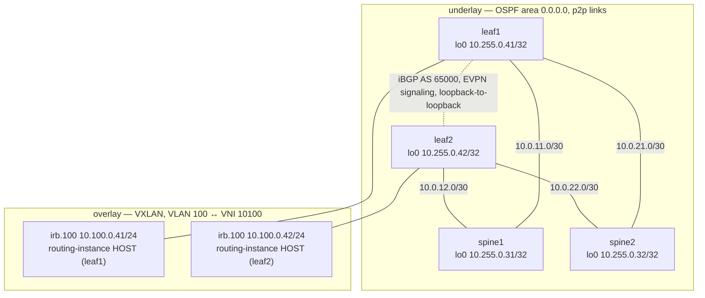

# Day 6 — spine/leaf, ECMP, EVPN-VXLAN

**Topology:** `lab/topologies/day-06-datacenter.toml` — spine1, spine2, leaf1, leaf2,
vJunos-switch 26.2R1.7. Configured entirely by the day-7 generator
(`day-07/automation/gen_fabric.py`), not by hand — see the generated set lines quoted below.

## Fabric diagram



Spines carry only underlay OSPF and the ECMP forwarding-table policy — no BGP, no VXLAN, no
VLAN config. Leaves carry the underlay plus the overlay (iBGP EVPN, VTEP, VLAN-to-VNI, irb,
and the `HOST` virtual-router instance). This is the "lean spine" shape named in the evidence
log: the spine's job is strictly IP forwarding between leaves.

## Underlay / overlay addressing

| Role | Address | Notes |
| --- | --- | --- |
| spine1 loopback | 10.255.0.31/32 | OSPF passive on lo0.0 |
| spine2 loopback | 10.255.0.32/32 | OSPF passive on lo0.0 |
| leaf1 loopback | 10.255.0.41/32 | VTEP source + BGP local-address |
| leaf2 loopback | 10.255.0.42/32 | VTEP source + BGP local-address |
| leaf1–spine1 link | 10.0.11.0/30 (spine .1 / leaf .2) | OSPF p2p, BFD 300 ms × 3 |
| leaf1–spine2 link | 10.0.21.0/30 (spine .1 / leaf .2) | OSPF p2p, BFD 300 ms × 3 |
| leaf2–spine1 link | 10.0.12.0/30 (spine .1 / leaf .2) | OSPF p2p, BFD 300 ms × 3 |
| leaf2–spine2 link | 10.0.22.0/30 (spine .1 / leaf .2) | OSPF p2p, BFD 300 ms × 3 |
| overlay AS | 65000 | iBGP, direct leaf1 ↔ leaf2 on loopbacks, family evpn signaling |
| VLAN 100 ↔ VNI | v100 → vni 10100 | `switch-options vtep-source-interface lo0.0` |
| irb.100 (leaf1) | 10.100.0.41/24 | in routing-instance `HOST` (virtual-router) |
| irb.100 (leaf2) | 10.100.0.42/24 | in routing-instance `HOST` (virtual-router) |

## What the generator actually wrote

Quoting `gen_fabric.py` output (`python3 day-07/automation/gen_fabric.py lab/topologies/day-06-datacenter.toml --outdir /tmp/fab6` — spine 16 lines, leaf 31 with BFD):

spine1 (underlay + ECMP only, no overlay):

```text
set interfaces lo0 unit 0 family inet address 10.255.0.31/32
set routing-options router-id 10.255.0.31
set routing-options autonomous-system 65000
set protocols ospf area 0.0.0.0 interface lo0.0 passive
set interfaces ge-0/0/0 description leaf1-spine1
set interfaces ge-0/0/0 unit 0 family inet address 10.0.11.1/30
set protocols ospf area 0.0.0.0 interface ge-0/0/0.0 interface-type p2p
set protocols ospf area 0.0.0.0 interface ge-0/0/0.0 bfd-liveness-detection minimum-interval 300
set protocols ospf area 0.0.0.0 interface ge-0/0/0.0 bfd-liveness-detection multiplier 3
set interfaces ge-0/0/1 description leaf2-spine1
set interfaces ge-0/0/1 unit 0 family inet address 10.0.12.1/30
set protocols ospf area 0.0.0.0 interface ge-0/0/1.0 interface-type p2p
set protocols ospf area 0.0.0.0 interface ge-0/0/1.0 bfd-liveness-detection minimum-interval 300
set protocols ospf area 0.0.0.0 interface ge-0/0/1.0 bfd-liveness-detection multiplier 3
set policy-options policy-statement ECMP then load-balance per-packet
set routing-options forwarding-table export ECMP
```

leaf1 (underlay + overlay, 31 lines — the BFD lines above are the same 8-line shape that the
day-7 fix deployed on top of the initial config):

```text
set interfaces lo0 unit 0 family inet address 10.255.0.41/32
set routing-options router-id 10.255.0.41
set routing-options autonomous-system 65000
set protocols ospf area 0.0.0.0 interface lo0.0 passive
set interfaces ge-0/0/0 description leaf1-spine1
set interfaces ge-0/0/0 unit 0 family inet address 10.0.11.2/30
set protocols ospf area 0.0.0.0 interface ge-0/0/0.0 interface-type p2p
set protocols ospf area 0.0.0.0 interface ge-0/0/0.0 bfd-liveness-detection minimum-interval 300
set protocols ospf area 0.0.0.0 interface ge-0/0/0.0 bfd-liveness-detection multiplier 3
set interfaces ge-0/0/1 description leaf1-spine2
set interfaces ge-0/0/1 unit 0 family inet address 10.0.21.2/30
set protocols ospf area 0.0.0.0 interface ge-0/0/1.0 interface-type p2p
set protocols ospf area 0.0.0.0 interface ge-0/0/1.0 bfd-liveness-detection minimum-interval 300
set protocols ospf area 0.0.0.0 interface ge-0/0/1.0 bfd-liveness-detection multiplier 3
set policy-options policy-statement ECMP then load-balance per-packet
set routing-options forwarding-table export ECMP
set protocols bgp group overlay type internal
set protocols bgp group overlay local-address 10.255.0.41
set protocols bgp group overlay family evpn signaling
set protocols bgp group overlay neighbor 10.255.0.42
set protocols evpn encapsulation vxlan
set protocols evpn extended-vni-list all
set switch-options vtep-source-interface lo0.0
set switch-options route-distinguisher 10.255.0.41:1
set switch-options vrf-target target:65000:1
set vlans v100 vlan-id 100
set vlans v100 vxlan vni 10100
set vlans v100 l3-interface irb.100
set interfaces irb unit 100 family inet address 10.100.0.41/24
set routing-instances HOST instance-type virtual-router
set routing-instances HOST interface irb.100
```

## Why OSPF for the underlay, not eBGP

OSPF area 0, one area, every node in it: for a four-node fabric this is the fewest moving
parts — one protocol, one area, loopbacks reachable in two hops at most, and the generator
only has to emit a handful of `set protocols ospf` lines per interface. eBGP-per-node (a
unique AS per box, as the large-fabric Clos designs do) buys policy control and avoids any
IGP convergence math at all — but that's a tool for when the fabric has enough leaves and
spines that OSPF's flooding domain and SPF runs start to matter. At two spines and two
leaves, eBGP-per-node is solving a scaling problem this lab doesn't have yet. OSPF is the
right choice for this size; eBGP is the right choice at the size where RFC 7938-style fabrics
live.

## Why direct leaf-to-leaf iBGP EVPN, not route reflectors on the spines

With exactly two leaves, a single iBGP session between leaf1 and leaf2's loopbacks is the
whole EVPN topology — no third node needed to reflect between them. This also keeps the
spines "lean": pure underlay IP forwarding, no BGP process, no VXLAN awareness, nothing
overlay-related to configure or break on them (confirmed by the generator: spine1's set file
has no `bgp`, `evpn`, or `vxlan` lines at all). The moment a third or fourth leaf joins, a
full mesh of leaf-to-leaf iBGP sessions stops being the right shape — that's exactly the point
at which route reflectors on the spines (or dedicated RRs) replace the full mesh, trading the
spines' statelessness for scale.

## ECMP evidence

On leaf1, the route to leaf2's loopback (10.255.0.42/32) came back as OSPF metric 2 with two
next hops: 10.0.11.1 via ge-0/0/0.0 and 10.0.21.1 via ge-0/0/1.0 — both spines, both in the
RIB. The forwarding table showed `ulst` (unilist), a unilist of both `ucst` next hops, which
is the FIB structure Junos uses to actually hash and load-balance traffic across multiple
paths — confirming ECMP exists in the forwarding table, not only in the route table.

## Failure-domain / blast-radius notes

**Drill 1 — local interface disable (leaf1 ge-0/0/0, to spine1):** 40/40 HOST pings across
the change succeeded. The route dropped immediately from two next hops to one (via spine2);
BGP stayed Established throughout. A local `disable` is carrier loss, and carrier loss is
instant — no detection delay at all.

**Drill 2 — spine1 shut (both fabric ports disabled on the spine itself):** leaf1's
ge-0/0/0 interface stayed `up up`, because the virtual bridge underneath it kept carrier even
though the far end (spine1) was down. leaf1 held 2 next hops for 37 seconds, then dropped to
1 next hop at t=40 s — the OSPF default dead-interval, with no BFD to shorten it. HOST pings
were 4/4 throughout the drill, consistent with that particular flow hashing onto the
surviving spine2 path; any flow that had hashed onto spine1 would have been black-holed for
up to ~40 seconds with nothing in the ping test to reveal it. spine2 kept both of its Full
OSPF neighbours, and the overlay BGP session between the leaves never dropped.

The blast radius of one spine failing is therefore: half of the ECMP paths (the flows hashed
onto it), for up to the dead-interval window — never the overlay, which is a direct
leaf-to-leaf session that doesn't transit the spine's control plane at all. The dangerous
part isn't the blast radius, it's the *detection* time without BFD.

**The fix, through the pipeline, not by hand:** the generator added BFD (300 ms interval × 3
multiplier) on each fabric-facing interface — the exact 8-line-per-node diff shown in the
leaf1/spine1 blocks above. Deploy validated on the first attempt; `show bfd session` on leaf1
showed 2 sessions Up with a 0.900 s detect time. Re-running drill 2 after the fix: leaf1
dropped to 1 next hop at the *first* sample taken, t=0 s — under roughly one second, down
from 40 seconds.

## The one thing to do differently on real hardware

The entire 40-second finding in drill 2 is a **virtual-lab artefact**: on physical links,
pulling or shutting the far end drops carrier immediately, so OSPF would have reacted on
link-down, not the dead interval. The virtual bridge under vJunos kept leaf1's interface
`up up` even with spine1 fully down, which is what let the dead-interval path run at all.

That doesn't make BFD optional on real hardware, though — it makes it necessary for a
different failure mode. A hung control plane (CPU pegged, OSPF process wedged) keeps physical
carrier up exactly the way this virtual bridge did, so BFD is still the only mechanism that
catches *that* failure quickly on real gear. The thing to actually change at real-hardware
scale is the underlay protocol choice itself: past the point where OSPF's single flooding
domain and SPF runs start to cost something, move to eBGP-per-node underlay, which is what
the fabrics this design will eventually resemble actually run.
